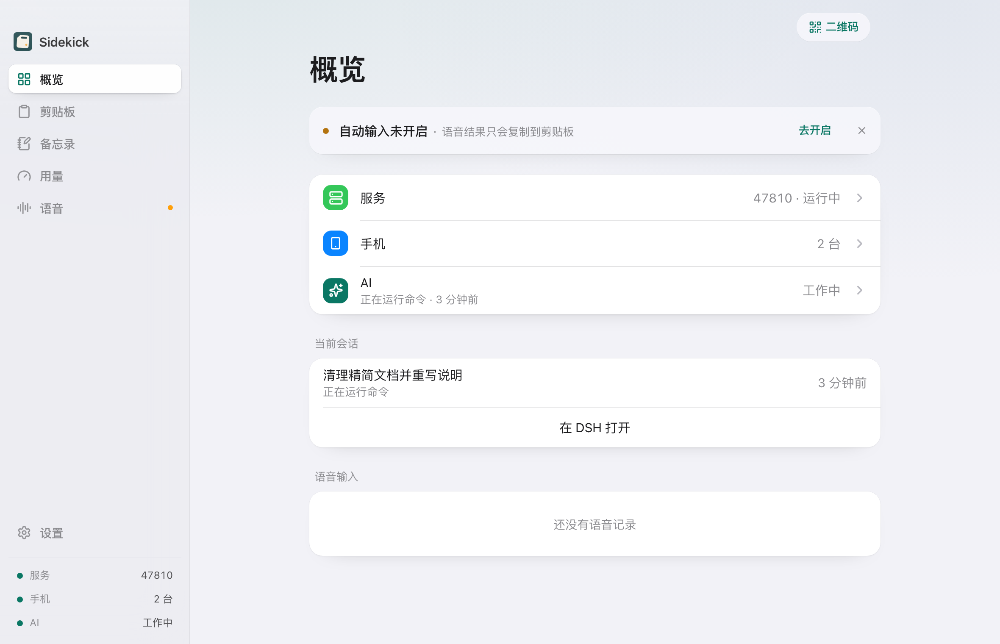
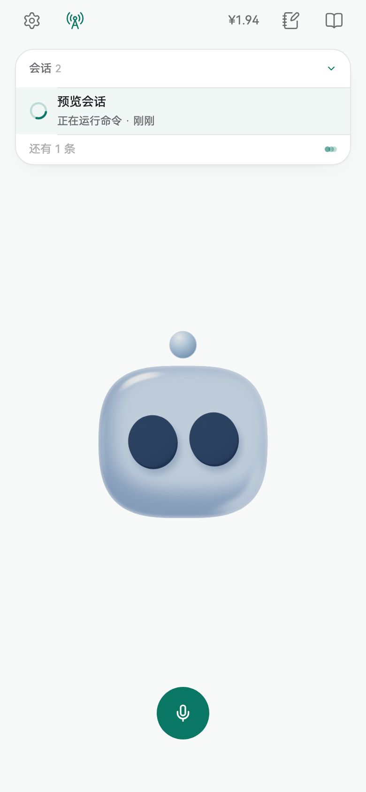
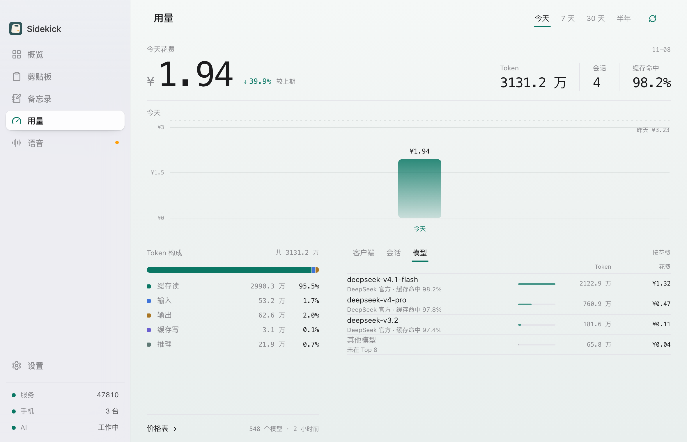
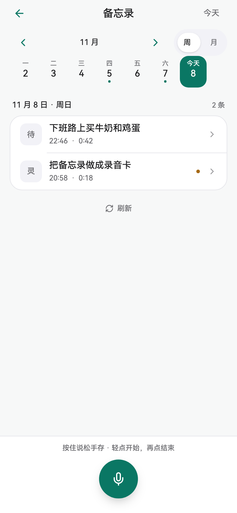

# Sidekick

<p align="center">
  
</p>

<p align="center">
  <a href="LICENSE"></a>
  <a href="https://tauri.app"></a>
  
  <a href="https://github.com/fouriyeo/sidekick/actions/workflows/ci.yml"></a>
</p>

把手机变成电脑的外设与 AI 宠物：电脑把 AI / 任务状态推到手机，你在手机上收状态、按住说话把文字送进电脑、看 Token 用量、录一段语音备忘录。

- 电脑端：macOS（Tauri 2，常驻菜单栏，关窗不退出服务）
- 手机端：Android（Tauri 2，竖屏；与电脑同局域网直连）

> 「小跟班」只是手机宠物角色的名字，App 名是 Sidekick（决策 D114）。

## 截图

| 电脑端 · 概览 | 手机 · 宠物页 |
| --- | --- |
|  |  |

| 电脑端 · 用量（深潜仪表） | 手机 · 语音备忘录 |
| --- | --- |
|  |  |

> 截图由 dev mock 生成（`node scripts/qa-shots.mjs`），不是真机投屏。

## 能做什么

| 能力 | 说明 |
| --- | --- |
| 手机 ↔ 电脑 | 同 Wi-Fi 自动发现（UDP 47820 + 端口回退）、断线自动重连、扫码/手动地址兜底 |
| 电脑端 7 个一级页 | 概览 ⌘1 · 剪贴板 ⌘2 · 备忘录 ⌘3 · 用量 ⌘4 · 语音 ⌘5 · 设置 ⌘6 · 英语角 ⌘7（Liquid Glass 壳） |
| 手机 | 宠物页 + 设置二级页 + 聊天/连接/回答页 + 语音备忘录/英语角全屏页 |
| 语音输入 | 按住手机说话 → 百炼云端流式识别 → 写剪贴板并合成 Cmd+V；结果卡可手动「回车 / 清空」 |
| 剪贴板 | 历史 / 搜索 / 置顶 / 隐私过滤，最多保留 100（可配 10–200） |
| Token 用量 | 只读本机 DeepSeek Harness（DSH）的 cost-meter 账本，桌面宽幅仪表 + 手机紧凑仪表 + 菜单栏小看板 |
| 语音备忘录 | 手机录音（前台）→ 分段转写 → LLM 归类（标题/类型/摘要/待办/标签）→ 本地库；电脑同局域网只读镜像 |
| AI 联动 | DSH hook 把 AI 四态与会话列表推到手机，点会话可在电脑唤起 DSH |
| 英语角 | 记录生词 → 百炼 qwen3.8-flash 解释（释义/音标/例句/搭配）→ 本机词库 → 用自己的词库造句；桌面与手机局域网双向同步 |

**还没做**：手机回答 AI 提问、文本消息、Claude Code / Qoder hook、配对鉴权、正式签名与公证、蓝牙通道、iOS。逐项状态见 [docs/status.md](docs/status.md)。

## 下载安装

安装包在 GitHub Releases：<https://github.com/fouriyeo/sidekick/releases/latest>

- `Sidekick-macOS.dmg`（arm64）：**未签名/未公证**，首次打开请右键 → 打开
- `Sidekick-Android.apk`（arm64）：release 签名；从 debug 包换过来需先 `adb uninstall dev.sidekick.app`

> 包里的 UI 字体是 HarmonyOS Sans、宠物形象来自 BoopFace（代码 MIT、角色形象不转让），两者的许可与例外见 [NOTICE.md](NOTICE.md)。

## 从源码运行

需要 macOS arm64、Rust、Node 24 + pnpm、JDK 21、Android SDK/NDK（手机端）；完整环境见 [docs/setup.md](docs/setup.md)。

```bash
cd app && pnpm install
pnpm tauri dev                 # 桌面端（窗口出现即 HTTP/WS 服务已启动）

scripts/build-android.sh       # 构建 Android debug APK（首次需 pnpm tauri android init）
scripts/install-android.sh     # 安装并启动（需 adb 已连接手机）

scripts/package-release.sh     # 打 release：先安卓后桌面 → release/
scripts/publish-release.sh     # 上传 GitHub Releases
```

手机与电脑连同一 Wi-Fi，打开 App 会自动发现并连接；企业网只放行单播时改用手动地址或扫码。发版完整流程见 [docs/engineering/release.md](docs/engineering/release.md)。

## 项目结构

```text
app/          Tauri 项目（桌面 + 安卓共用；src/{desktop,mobile,shared,protocol}）
brand/        品牌母版与矢量标记（appicon.png + logo-mark*.svg）
protocol/     手机 ↔ 电脑事件协议
docs/         文档树（入口 docs/INDEX.md）
release/      本地构建产物（不入库）
scripts/      构建 / 安装 / 打包 / 发布 / QA / 文档检查
```

## 文档

- [AGENTS.md](AGENTS.md) — 给 AI / 新协作者的入口（项目上下文、命令、Top 12 坑）
- [docs/INDEX.md](docs/INDEX.md) — 文档树入口（树形 + 懒加载）
- [docs/status.md](docs/status.md) — 当前状态、待验收、下一步
- [docs/architecture.md](docs/architecture.md) — 拓扑、模块、数据与存储
- [docs/engineering/pitfalls.md](docs/engineering/pitfalls.md) — 踩过的坑与硬约束
- [docs/decisions.md](docs/decisions.md) — 决策记录（含取代关系）
- [docs/engineering/release.md](docs/engineering/release.md) — 发版 runbook
- [docs/setup.md](docs/setup.md) — 环境、构建、调试

## 隐私与数据

- 所有数据都在本机：`~/.sidekick/`（`asr.json`、`clipboard.json`、`sidekick.db` 等，权限 0600）。
- 语音输入需要你自己在电脑上配置百炼 API Key；音频只在你配置的百炼与两台设备之间流转，不经过第三方服务器。
- 语音备忘录按设计把录音留在手机 App 私有目录（可删）；是否上传只取决于你是否配置了百炼。
- AI 联动只上报状态、会话标题、粗粒度工具类别，不含提示词、回复、工具参数、文件路径。

## 已知限制

- 局域网通信**没有鉴权与加密**，请只在可信网络中运行，不要把服务端口暴露到公网。
- 需要手机与电脑在同一网段；部分企业网只放行单播，自动发现会失效（手动地址/扫码兜底）。
- 协议无心跳；macOS 安装包未签名、未公证；iOS 端尚未开始。

## 贡献

- 提交前请读 [.github/CONTRIBUTING.md](.github/CONTRIBUTING.md)：`pnpm typecheck && pnpm lint && pnpm test && pnpm build`，以及 `node scripts/check-docs.mjs`、`node scripts/check-boundaries.mjs`。
- 提交信息用中文（`type(scope): 中文摘要`），规则见 [docs/standards/git.md](docs/standards/git.md)。
- 安全问题请走 [.github/SECURITY.md](.github/SECURITY.md)，不要公开提 issue。

## 许可

- 源码以 [MIT](LICENSE) 发布。
- **第三方**：手机宠物使用 [BoopFace](https://github.com/CX-ArtLab/BoopFace)（MIT，© CX ArtLab）；其角色形象不随 MIT 转让，本项目只把它作为 App 内形象使用、不宣称为原创角色。随包 HarmonyOS Sans 字体受其自身许可约束。详见 [NOTICE.md](NOTICE.md)。
- 「Sidekick」为本项目代号，与其它同名产品无关。
